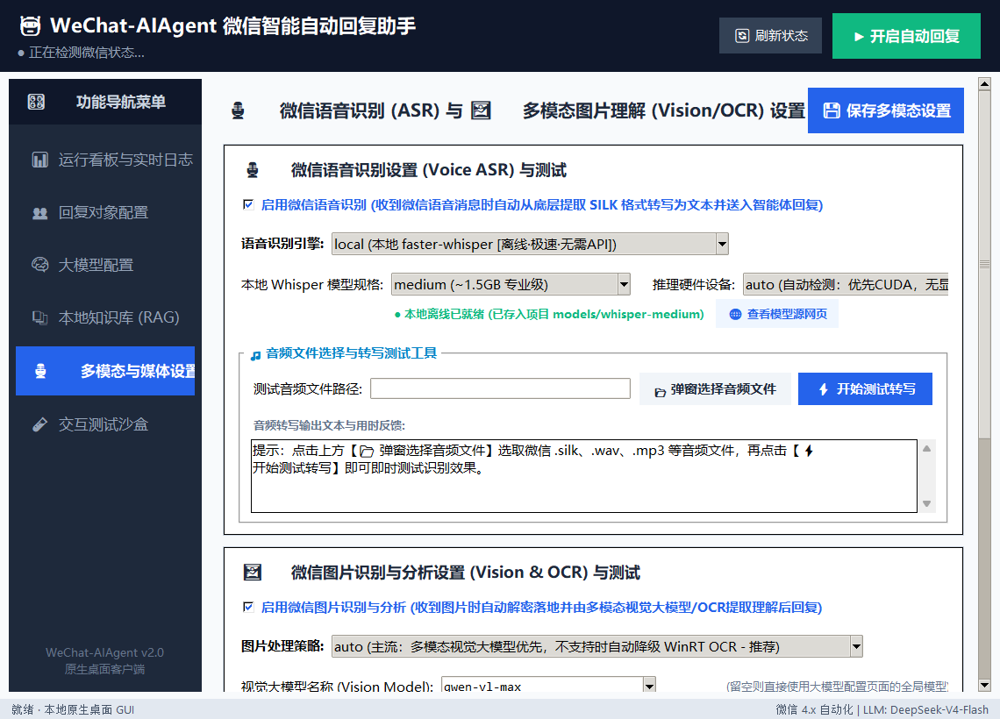

# 🤖 WeChat-AIAgent · 微信 4.x 全功能 AI 智能助理

<div align="center">

> **专为微信 4.x Windows 客户端打造的个人 AI 智能助理**  
> 集成 **本地原生桌面 GUI (现代竖向导航)** · **多主流大模型 (LLM)** · **联系人专属立体画像与永久记忆 (Memory Engine)** · **本地私有知识库 (BM25 RAG)** · **📞 微信语音电话自动接听与全双工实时 AI 对话 (VoIP Agent)** · **离线/云端语音识别 (ASR)** · **多模态视觉与 OCR 解析** · **群管与自动踢人**

[](https://microsoft.com/windows)
[-brightgreen.svg)](https://weixin.qq.com)
[](https://python.org)
[-orange.svg)](https://github.com/SYSTRAN/faster-whisper)
[](LICENSE)

</div>

---

## 📖 项目简介

本项目底层自动化引擎深度衍生并重构自开源项目 [wechatauto-replica](https://github.com/fanyuantaier/wechatauto-replica)，突破了经典 wxauto 库因微信 4.x 换用自绘渲染引擎导致 UI 自动化树失效的限制，创新实现：

1. **本地内存解密**：从微信 4.x 进程提取密钥，无侵入解密 `contact.db`、`message_*.db`（SQLCipher 4），实现高速消息监听与会话捕获；
2. **混合发信驱动引擎**：结合 Qt 内存可访问性热激活、UIAutomation 与 WinRT OCR 屏幕文字定位技术，实现高稳定自动打字、发信与群成员管理。

在此基础上完成**全面产品级演进与智能化升级**：
- 沉浸式**原生桌面 GUI**（左侧垂直深色导航侧边栏 + 右侧功能面板现代化布局）；
- 完整 **AI Agent 决策管道**与**会话级多轮上下文记忆**；
- **联系人专属立体画像与永久记忆库**（Memory Engine）；
- **本地私有 BM25 检索增强知识库**（RAG）；
- 🆕 **微信语音电话自动接听 + 实时全双工 AI 对话**（VoIP Agent）；
- **双模态语音转写**（本地 faster-whisper + 云端 ASR）；
- **多模态视觉大模型 + WinRT OCR** 图片综合理解；
- 全量内置**绿色便携 Python 运行时 (runtime)**，开箱即用。

---

## ✨ 核心功能全览

### 1. 🎛️ 现代原生桌面 GUI (竖向排列布局)

- **左侧深色垂直功能侧边栏**：告别顶部横向标签容易出现的文字截断与挤压，支持选中高亮微动效与鼠标悬浮响应，直观高效；
- **8 大核心功能面板**：

| 面板 | 功能说明 |
| :--- | :--- |
| 📊 **运行看板与实时日志** | 今日接收 / 自动回复 / 规则过滤三大指标卡，彩色实时日志流 |
| 👥 **回复对象与群管配置** | 联系人/群聊白名单精准勾选，群管理员授权，`@用户 踢` 自动踢人拉黑 |
| 🧠 **大模型接口配置** | 兼容 DeepSeek、OpenAI、通义千问等所有 OpenAI 规范 API，一键拉取模型，连通性测试 |
| 📚 **本地私有知识库 (RAG)** | BM25 稀疏检索切片，支持 `.txt` `.md` `.pdf` `.docx` `.csv`，磁盘索引缓存秒启 |
| 👤 **用户画像与永久记忆** | 联系人立体画像，增量自完善与认知纠偏，事实记忆碎片，历史记录全量建档 |
| 🎙️ **多模态与媒体设置** | 语音 ASR 引擎切换（本地/云端），缺模型自动唤起极速镜像下载，视觉/OCR 解析 |
| 📞 **语音电话守护 (VoIP)** | 微信语音来电自动接听/拒接，实时全双工 AI 对话，多 TTS 音色，声音克隆 |
| 🧪 **交互测试沙盒** | 模拟消息输入，无缝测试 RAG 命中、画像记忆注入与 AI 回复效果 |

---

### 2. 📞 微信语音电话守护 (VoIP Agent) — 全新重磅功能

> 微信语音来电 → 毫秒级自动探测 → 物理鼠标精准点击接听 → 实时全双工双向语音对话。全程由 AI 接管，无需人工干预！

#### 完整技术架构

```
微信来电弹窗 (mmui::VOIPTrayWindow)
    │
    ▼
VoIPWatcher (Win32 + UIAutomation 毫秒级探测)
    │  白名单过滤 → 几何精确推算 (接听键=右侧86%) → 物理模拟鼠标点击
    ▼
AudioRouter (虚拟声卡双工音频路由 · VB-Audio CABLE)
    │  输入流: 对方语音 → STTWorker
    │  输出流: AI 合成语音 → 注入微信麦克风
    ▼
STTWorker (Faster-Whisper + Silero VAD 实时端点检测)
    │  声学回声消除 (AcousticClassifier 双层指纹策略: F0基频+MFCC+频谱质心)
    │  实时转写对方语音文字
    ▼
DialogueEngine (大模型流式对话引擎)
    │  联系人画像与长期事实记忆注入 · 实时多轮上下文管理
    ▼
TTSManager (Edge-TTS / ChatTTS / Qwen3-TTS / 声音克隆)
    │  有序流水线并发合成 · 智能断句分片 · Generation ID 打断撤销机制
    ▼
AudioRouter.play_audio() → 推流至虚拟声卡注入微信
```

#### 核心技术亮点
- 🔍 **精准无感接听**：多层 Win32/UIA 探测微信 4.x `mmui::VOIPTrayWindow` 弹窗，严格按几何推算坐标（绿色接听按键位于右侧 86%）物理点击，杜绝误触挂断按键；
- ⚡ **智能打断唤醒 (Barge-in)**：Silero VAD 毫秒级检测对方人声，一旦对方开口立即停止当前 AI 发音，清空音频队列，秒速转入倾听；
- 🔇 **双层声学回声消除**：预建立 AI 音色声学指纹（F0 基频、MFCC 倒谱、频谱质心）结合波形互相关校验，从根本上防止 AI 自己的声音被麦克风二次录入导致的自言自语或死锁；
- 🎵 **多引擎 TTS 支持**：内置 Edge-TTS（免费极速、真人音色丰富）、ChatTTS、Qwen3-TTS 本地离线推理，并支持自定义声音克隆；
- ⏱️ **流水线并发生成**：流式 LLM 输出结合多句异步并发 TTS 合成，配合 Generation ID 保序分发，首字到发音延迟低至 1 秒以内；
- 🛡️ **自动守护与挂断**：支持最大通话时长保护自动挂断、守护线程异常自愈、多设备热插拔自恢复。

---

### 3. 👤 联系人专属立体画像与永久记忆 (Memory Engine)

- **历史记录全量建档**：从已有聊天记录分析身份定位、性格特质、沟通偏好与核心事实记忆（Fact Memories）；
- **动态增量自完善与认知纠偏**：聊天开始即自动生效，智能体在后续每一轮对话中自发提取新事实，发现信息变更自动更新校准；
- **严格对齐微信命名规范**：界面与索引优先使用好友备注名，无备注显示微信昵称，绝不展示难认的原始 wxid；
- **群聊成员画像独立开关**：群聊成员画像默认关闭，避免浪费算力与存储；可针对核心群聊单独开启；
- **物理强隔离存储**：每个联系人独立存储为 `data/profiles/{safe_id}.json`，互不影响、绝不混淆。

---

### 4. 🤖 智能对话与群聊自动化

- **独立上下文多轮记忆**：每个好友、每个群聊均维持独立的对话历史滑动窗口；
- **群聊管理员与群管指令**：群管理员在群内发送 `@违规用户 踢` 时，智能体自动识别并将其**移出群聊并加入黑名单**；
- **私有知识优先回复**：收到消息后优先在本地 RAG 知识库中进行 BM25 检索，命中高相关切片直接回答，无匹配时由大模型自然发挥；
- **自动防风控与人性化延时**：模拟真人打字间隔与思考延迟，支持后台静默运行。

---

### 5. 🎙️ 语音识别与多模态图片

- **微信语音自动提取与转写**：底层提取加密 SILK 音频转为 WAV，送入本地 `faster-whisper`（支持 GPU CUDA / CPU）或云端 ASR；
- **缺失模型自动引导**：本地缺少模型时，点击测试自动唤起系统浏览器直达国内极速镜像下载页；
- **云端 ASR 一键获取**：支持从上游 API 一键拉取可用模型列表并在下拉栏便捷切换；
- **图片多模态与 OCR**：主流优先调用视觉大模型（如 `qwen-vl-max`, `gpt-4o` 等）理解图意；纯文本自动降级 Windows 原生硬件加速 **WinRT OCR** 离线提取。

---

## 🖥️ 软件界面预览

### 🎙️ 多模态与媒体设置面板 (展示竖向侧边栏与现代布局)


---

## 🛠️ 环境要求

| 项目 | 要求 | 说明 |
| :--- | :--- | :--- |
| **操作系统** | Windows 10 / Windows 11 (64位) | 推荐 Windows 10 20H2 及以上 / Windows 11 |
| **微信版本** | 微信 4.x Windows 客户端 (`Weixin.exe`) | 实测支持 4.1.12 及以上版本 |
| **登录状态** | 微信必须**已登录**并保持运行 | 本地数据库解密密钥存于进程内存中，请勿锁屏 |
| **Python** | 3.9 ~ 3.12 | 项目已全量内置便携式绿色运行环境，无需自行安装 |
| **虚拟声卡** | VB-Audio CABLE（用于语音电话守护） | 项目内置 `install_vbcable.bat` 一键自动安装 |

---

## 🚀 快速启动

### 方式一：开箱即用（推荐）

本项目已全量内置预配齐所有依赖的绿色便携 Python 运行时环境，无需配置环境变量：

1. **克隆本项目**：
   ```bash
   git clone https://github.com/fj9876/wechat-auto.git
   cd wechat-auto\wechatauto-replica
   ```

2. **安装虚拟声卡（如需语音电话功能）**：
   双击运行 👉 **`install_vbcable.bat`** 一键安装 VB-Audio CABLE 虚拟声卡驱动。

3. **一键启动客户端**：
   双击运行 👉 **`run_ui.bat`**，系统将自动使用内置 `runtime` 环境启动原生桌面 GUI！

### 方式二：自建 Python 虚拟环境（开发者）

```bash
cd wechatauto-replica
python -m venv venv
venv\Scripts\activate
pip install -r requirements.txt
pip install winsdk faster-whisper tokenizers
python gui_app.py
```

---

## 📋 详细使用步骤

### 第一步：配置大语言模型 (Tab: 🧠 大模型配置)
1. 点击左侧竖向导航【🧠 大模型配置】；
2. 填写 API 地址（如 DeepSeek 官方 `https://api.deepseek.com/v1`、硅基流动或 OpenAI 地址）与对应的 `API Key`；
3. 点击【🔍 一键拉取上游可用模型】或直接在下拉框选择所需模型；
4. 点击【⚡ 测试 API 连通性】，确认成功后点击【💾 保存大模型配置】。

### 第二步：配置回复对象白名单 (Tab: 👥 回复对象配置)
1. 点击左侧【👥 回复对象配置】；
2. 客户端会自动从本地微信数据库读取联系人与群聊列表（自动过滤公众号与服务号）；
3. 勾选需要开启 AI 自动回复的好友或群聊；
4. 如需启用群管指令，在右侧填入「群管理员微信昵称」，即可在群内使用 `@成员 踢` 执行踢人。

### 第三步：配置本地 RAG 知识库 (可选 · Tab: 📚 本地知识库)
1. 点击左侧【📚 本地知识库 (RAG)】并勾选「启用本地知识库检索」；
2. 点击【📂 选择本地文件夹】，选取产品手册或问答文档所在目录；
3. 点击【🔄 立即构建/重置知识库索引】，生成 BM25 稀疏索引与 `.rag_cache.json` 磁盘缓存。

### 第四步：管理用户画像与永久记忆 (Tab: 👤 用户画像)
1. 点击左侧【👤 联系人用户画像】；
2. 点击任意联系人，可查看身份定位、沟通偏好与事实记忆；
3. 点击【🔍 基于已有聊天记录分析/重建画像】可根据历史消息自动建档。

### 第五步：配置多模态与语音 ASR (可选 · Tab: 🎙️ 多模态与媒体设置)
1. 点击左侧【🎙️ 多模态与媒体设置】；
2. **语音识别**：选择 `local (本地 faster-whisper)` 引擎或云端 ASR。缺失模型点击测试将自动打开极速镜像下载页面；
3. **图片理解**：推荐使用 `auto` 策略，多模态大模型优先，纯文本平滑降级为 Windows 原生 WinRT OCR。

### 第六步：配置语音电话守护 (可选 · Tab: 📞 语音电话守护)
1. 确保已运行 `install_vbcable.bat` 安装虚拟声卡；
2. 在「自动接听白名单」中勾选允许自动接听的好友；
3. 选择 TTS 引擎（推荐默认 Edge-TTS，免费且发音极其自然）；
4. 检查音频设备：输入设备选择 `CABLE Output`，输出设备选择 `CABLE Input`；
5. 点击【▶ 开启电话守护】，守护线程开始探测微信语音来电并执行全自动接听与对话。

### 第七步：开启自动回复 (Tab: 📊 运行看板与实时日志)
- 回到【📊 运行看板与实时日志】面板，点击右上角绿色的 **【▶ 开启自动回复】** 按钮；
- 状态栏将变为绿色就绪状态，控制台将实时输出思考轨迹与回复记录！

---

## 📁 目录结构

```
wechat-auto/
├── README.md                      # 项目统一官方中文说明文档
├── LICENSE                        # MIT 开源许可证
├── run_ui.bat                     # 根目录一键启动快捷脚本
├── setup_env.bat                  # 环境配置脚本
├── install_vbcable.bat            # 虚拟声卡一键安装脚本
├── docs/                          # 文档与截图资源
│   └── vertical_gui_preview.png   # 原生桌面客户端界面预览图
├── tools/vbcable/                 # VB-Audio CABLE 官方驱动安装包
└── wechatauto-replica/            # 核心应用程序工程
    ├── run_ui.bat                 # 核心启动脚本
    ├── setup_env.bat              # 便携环境安装与依赖配置脚本
    ├── install_vbcable.bat        # VB-Audio CABLE 驱动安装脚本
    ├── gui_app.py                 # 原生桌面客户端入口 (8 大功能面板)
    ├── config.json                # 全局应用配置持久化文件 (gitignore，本地生效)
    ├── config.example.json        # 官方脱敏配置模板 (可供参考配置)
    ├── requirements.txt           # 核心 Python 依赖清单
    │
    ├── agent_core/                # 智能体核心架构模块
    │   ├── config.py              # 配置数据模型 (LLM、RAG、画像、VoIP 等)
    │   ├── config_manager.py      # 配置持久化与热加载管理器
    │   ├── llm_client.py          # 大语言模型客户端与连通性检测
    │   ├── media_engine.py        # 语音转写 (faster-whisper) 与图片视觉/WinRT OCR
    │   ├── pipeline.py            # 对话上下文管理与 Agent 思考执行管道
    │   ├── profile_engine.py      # 用户画像与长期事实记忆引擎
    │   ├── rag_engine.py          # 本地 BM25 检索知识库与磁盘缓存
    │   ├── tools.py               # 群管踢人、群成员检测等工具执行器
    │   ├── wechat_bridge.py       # 微信底层消息监听与发信桥接层
    │   └── voice_call/            # 📞 语音电话守护核心模块
    │       ├── call_agent.py      # 语音电话总控与生命周期调度
    │       ├── voip_watcher.py    # 来电弹窗毫秒级探测与精准点击接听
    │       ├── audio_router.py    # 虚拟声卡双工音频路由与自愈
    │       ├── stt_worker.py      # 实时语音端点识别 (Whisper + Silero VAD)
    │       ├── dialogue_engine.py # 流式大模型对话生成引擎
    │       ├── tts_manager.py     # TTS 多引擎管理与有序流水线并发分发
    │       ├── acoustic_classifier.py # 声学回声消除判别器 (音色指纹+互相关)
    │       ├── voice_clone.py     # 声音克隆管理器
    │       └── voip_tab_builder.py# VoIP GUI 面板构建器
    │
    ├── data/profiles/             # 联系人专属立体画像独立存储目录 (*.json)
    ├── models/                    # 本地 Whisper 离线语音模型目录 (按需下载)
    ├── runtime/                   # 全量内置绿色免安装 Python 运行时环境
    └── wechatauto/                # 微信 4.x 底层自动化核心库 (DB解密/UIA驱动/发信)
```

---

## ❓ 常见问题 (FAQ)

### Q1: 提示“未检测到运行中的微信进程”？
请确认您的电脑已登录官方微信桌面客户端（任务管理器中进程名为 `Weixin.exe`，版本需为 4.x），微信保持在后台运行或常规窗口，请勿锁定 Windows 屏幕。

### Q2: 语音电话接听失败 / 鼠标没有动作？
- 确认已在【📞 语音电话守护】面板点击【▶ 开启电话守护】；
- 确认来电方已在「自动接听白名单」中勾选；
- 检查日志输出中是否包含 `几何推算坐标(接听=右侧86%)`；
- 建议屏幕 DPI 缩放保持在 100% 以获得最高精度的物理坐标点击。

### Q3: 通话时 AI 不说话 / 几轮后没有反应？
这是由于早期版本中打断后旧指纹误判引起的声学回声消除死锁。本项目已彻底修复此问题。如使用自建环境，请确保同步拉取了最新代码。

### Q4: 语音识别缺少模型，如何下载？
在【🎙️ 多模态与媒体设置】中选择对应模型规格后，直接点击下方【🌐 打开模型极速下载网页】，软件将自动在本地浏览器打开国内极速镜像下载页。将权重文件放入 `models/whisper-{规格}` 目录后重新点击测试即可。

### Q5: 群聊踢人指令 `@用户 踢` 没有反应？
请确保当前运行机器人的微信号是该群的**群主或群管理员**，并在【👥 回复对象配置】面板右侧填入准确的「群管理员微信昵称」。

### Q6: 提示 `No module named 'tokenizers'` 或 `faster_whisper` 报错？
本项目内置的 `runtime` 环境已完整打包全部运行库（双击 `run_ui.bat` 即可）；若是自建环境，请运行 `pip install tokenizers faster-whisper`。

---

## ⚖️ 免责声明与开源许可

1. **用途限制**：本项目仅供个人技术研究、编程学习及日常效率提升使用，使用者须严格遵循《微信个人账号使用规范》及相关法律法规；
2. **安全无侵入**：本项目未采用任何破坏微信进程安全机制的 DLL 注入手段，消息读取基于本地已授权数据库文件，驱动基于 Windows 原生无障碍可访问性接口；
3. **开源许可**：本项目基于 [MIT License](LICENSE) 协议开源。
